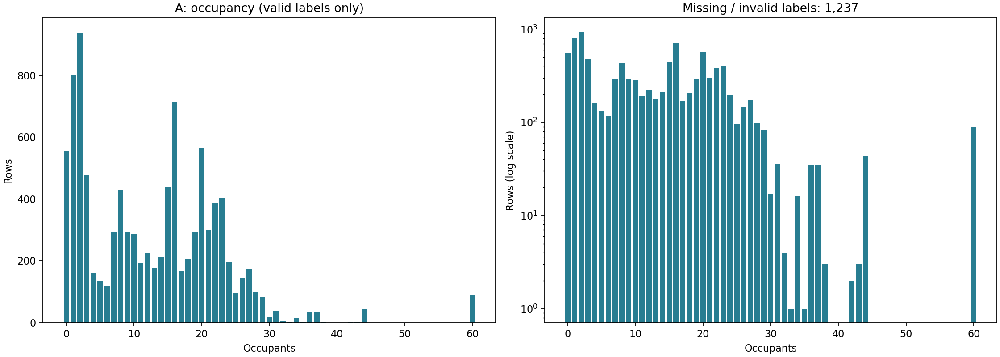
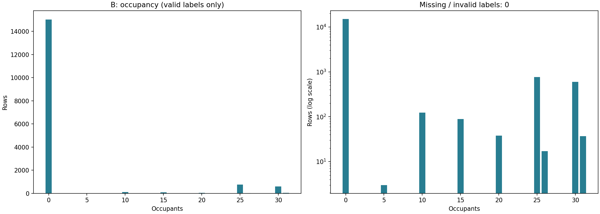
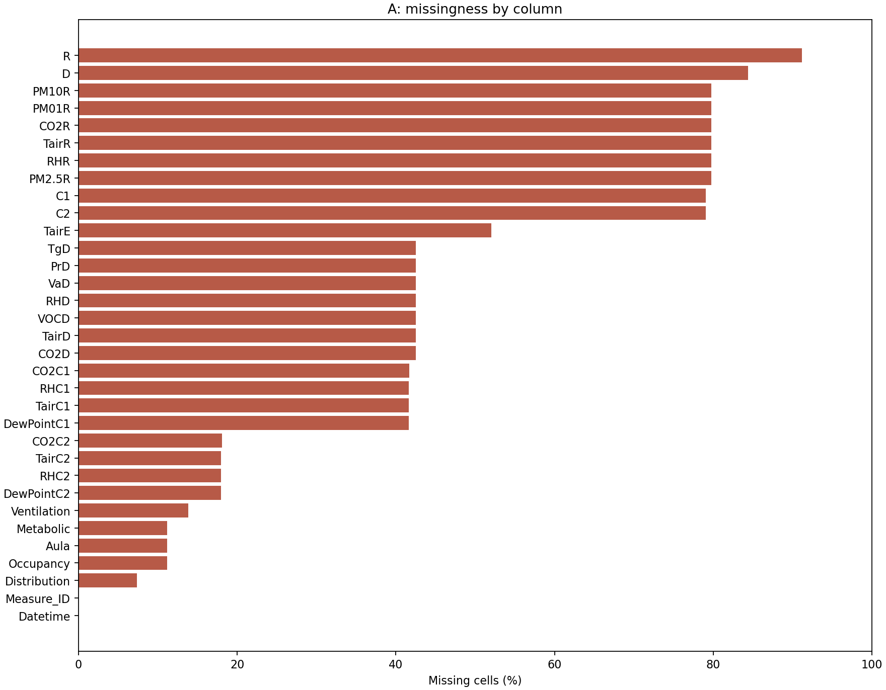
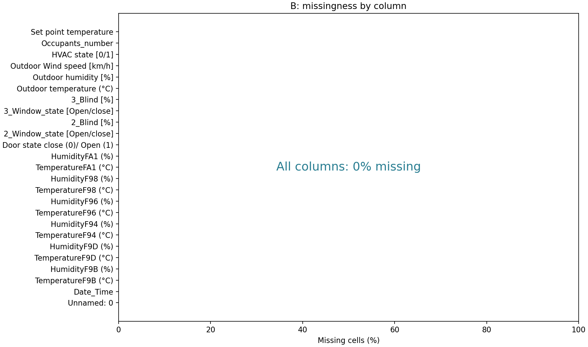
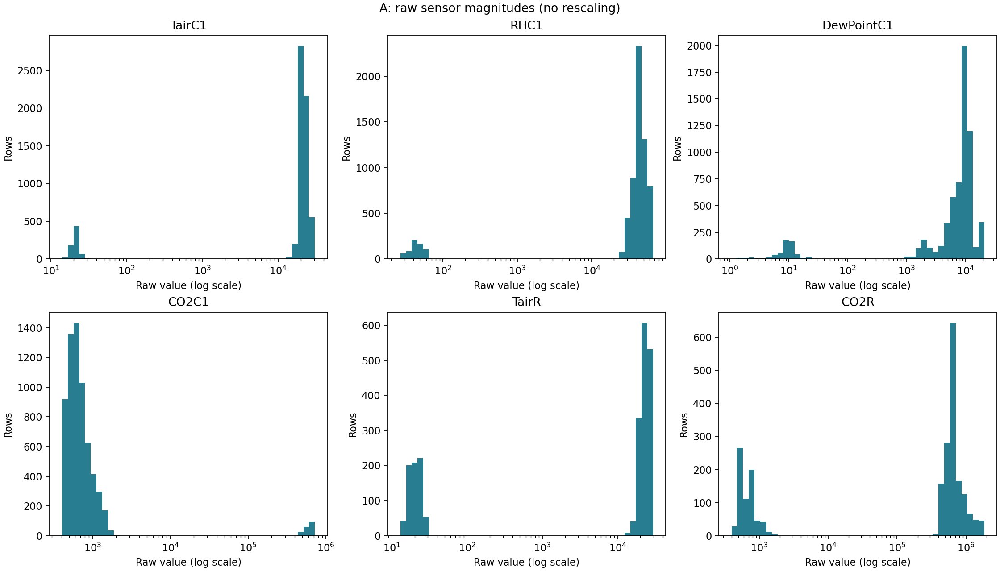
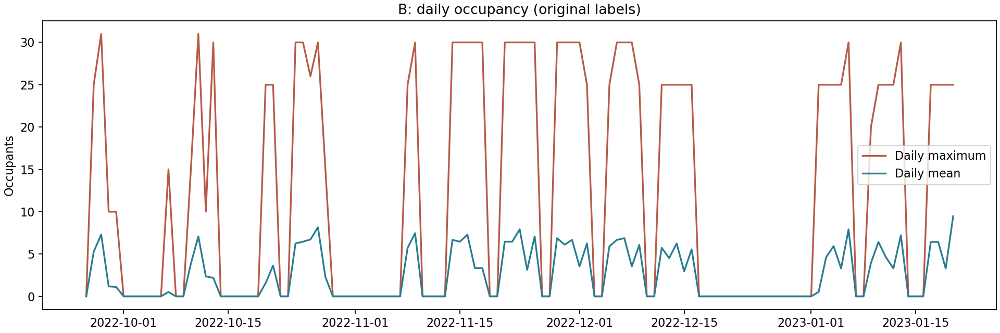

# OccupancySense 数据集质量审核

审核日期：2026-10-26。只读审核；未清洗、插补、修正量纲、构造训练特征、划分训练集或训练模型；未合并 A/B。两份输入的运行前后 SHA-256 一致，见 `metrics/audit_summary.json`。

## 推荐结论

**建议将 B 作为当前工程基线主数据集，A 作为修复与溯源后的多教室扩展数据集。** B 标签完整、时间规则、室内温湿度量纲一致，更适合先建立可复现流程；但 90% 为空教室、人数只有少量离散取值、没有 CO₂ 或教室标识，不能据此证明精细人数估计或跨教室泛化能力。若项目目标必须包含 CO₂ 或跨教室人数估计，则保留 A 为目标主数据集，但在解决量纲、重复来源与标签缺失前不宜直接训练。

## 数据概况

| 数据集 | 样本/字段 | 有效人数标签 | 标签缺失 | 单元格缺失率 | 空教室占有效标签 | 人数范围/取值数 | 整行重复(多余行) |
| --- | --- | --- | --- | --- | --- | --- | --- |
| A | 11,085 / 33 | 9848 | 1237 | 44.09% | 5.65% | 0–60 / 43 | 0 |
| B | 16,700 / 25 | 16700 | 0 | 0.00% | 90.00% | 0–31 / 9 | 0 |

有效标签要求：可解析为有限数值、非负整数，且 A ≤ 60、B ≤ 31（本项目已知范围，不是普遍人数上限）。A/B 的非缺失非法标签分别为 0 / 0。缺失率分母为全部行；人数分布同时提供全样本占比，空教室占比分母为有效标签。A 全字段完整行仅 387 条，B 为 16700 条，不建议对 A 全字段直接 dropna。

## 传感器与量纲

阈值为审核筛查假设，不是传感器量程或认证标准：温度 −50～60 °C、露点 −50～50 °C、湿度 0～100%、CO₂ 250～10000 ppm、颗粒物 0～1000（单位暂假设 µg/m³）、气压 800～1100 hPa、室内风速 0～20 m/s、室外风速 0～200 km/h。VOC 仅查非负；Metabolic 暂按 0.5～10 met 筛查。边界包含端点，空值不计入传感器异常分母。离群值仅标记，不能等同错误；原始尺度 1.5×IQR 结果另存，不用于自动删除。

A 原始 CSV 已含 `19025.0`、`41742.0` 等值，问题并非本次读入后产生。以下列同时存在正常量级和异常量级；“÷1000 候选”仅表示原值越界、绝对值 ≥1000 且除以 1000 后落入筛查区间：

| column | observed | in_range_raw | outside_range | divide_1000_candidates |
| --- | --- | --- | --- | --- |
| TairC1 | 6469 | 703 | 5766 | 5766 |
| RHC1 | 6469 | 624 | 5845 | 5845 |
| DewPointC1 | 6469 | 578 | 5891 | 5889 |
| CO2C1 | 6465 | 6289 | 176 | 176 |
| TairC2 | 9095 | 681 | 8414 | 8414 |
| RHC2 | 9095 | 861 | 8234 | 8234 |
| DewPointC2 | 9095 | 891 | 8204 | 8204 |
| CO2C2 | 9078 | 8902 | 176 | 176 |
| CO2R | 2245 | 707 | 1538 | 1538 |
| TairR | 2245 | 723 | 1522 | 1522 |
| RHR | 2245 | 688 | 1557 | 1557 |
| PM01R | 2245 | 1651 | 594 | 594 |
| PM2.5R | 2245 | 1581 | 664 | 664 |
| PM10R | 2245 | 1569 | 676 | 676 |
| Metabolic | 9848 | 9708 | 140 | 18 |

这支持部分行存在千倍尺度或小数解析错误的**假设**，不证明所有异常都应除以 1000，尤其 CO₂、PM 和 Metabolic 需要原始说明与设备量程核实。不能整列统一除以 1000。按 Measure_ID 的异常/缺失统计见 `A_sensor_checks_by_measure.csv`，可判断组内是否也混用尺度。CO2D、TairD、TgD、RHD 等可作为人工交叉核验参考，但不同设备位置与响应时间未必相同。

B 的筛查异常：

| column | min | max | outside_range |
| --- | --- | --- | --- |
| Outdoor humidity [%] | 30.6207870149926 | 100.687924421762 | 8 |
| Outdoor Wind speed [km/h] | -1.39849789563877 | 50.7079145789778 | 30 |

室外湿度略超 100%、风速为负，应核查天气数据插值或采集来源，不能凭数值外观断定原因。设定温度 0 可能表示关闭/不适用，需结合 HVAC 状态解释，不能自动视为真实 0 °C。B 温度列名实际含 `°C`；若终端显示乱码，应检查终端编码，不应据此修改原始列名。

## 时间、分组和重复风险

- A 原始时间范围：2021-11-16 12:28:00 至 2222-03-07 12:03:00。有 2 条未来时间，排除未来时间后的诊断范围为 2021-11-16 12:28:00 至 2022-06-21 14:13:00；这只是统计过滤，未修改数据。有 467 行日期与 Measure_ID 的前八位日期不同，不能未经核对就按 ID 覆盖。
- B 时间范围：2022-09-26 17:50:00 至 2023-01-20 17:00:00。本次检查相邻间隔均为 600 秒（10 分钟），无倒序或重复时间，见 `B_time_intervals.csv`。A/B 时间解析失败或缺失分别为 0 / 0。
- A 有 55 个 Measure_ID、34 个非空 Aula 名称；Aula 缺失 1237 行。Aula 是名称而非全局教室 ID，如 A1/A2 可能在不同学校复用，不能把名称数直接当实际教室数。学校信息嵌于 Measure_ID，但命名格式与别名不统一，需来源表确认。
- 两份数据全字段重复均为 0；A 排除 Measure_ID 后有 **330 条多余重复行**，跨 ID 的相同观测详见 `A_cross_measure_duplicates.csv`。仅用原始 Measure_ID 分组仍可能泄漏；应先确认同源测量与别名，并把相关组放入同一分区。
- A 的 Aula+Datetime 候选重复多余行数为 1219，可能含不同学校同名教室、缺失 Aula 或同一观测重复，不能直接据此删除。Measure_ID+时间重复多余行数为 0。
- 按测量组内时间排序，相邻有效标签相同占比 A 为 88.47%，B 为 98.19%（仅正时间间隔；未排除长间隔）。这是序列依赖的诊断，不能视为独立样本证据。随机按行拆分容易把相邻时刻、同一课堂、同源重复分到两边。
- A 应按确认后的学校+物理教室/测量会话分组评估；跨教室目标应留出整间教室或学校。同一教室未来预测采用时间外推。B 缺少教室及 Measure_ID 字段，只能确认一条时间序列，无法从本文件证实教室数量；建议按连续日期/周留出后期测试集，窗口跨边界时设置隔离带，长度取决于后续窗口和预测跨度。
- 所有未来的插补、标准化、特征选择及重采样都只能在训练分区拟合。标签、同源 ID、时间索引不直接作为环境传感器输入。日期/时段可能记住课表，若后续使用应单独做消融，并核实推理时可获取。

## 可用特征与后续建议

| 数据集 | 候选特征 | 条件与暂缓项 |
| --- | --- | --- |
| B | 六组室内 TemperatureF*/HumidityF*；室外温度 | 核心候选；六个通道不能当成六间教室。验证传感器冗余，保持时间留出 |
| B | 室外湿度、风速 | 先核实异常的来源和处理规则 |
| B | 门窗、百叶、HVAC、Set point temperature | 仅在预测当时可获取时使用；控制动作可能响应人数，需要单独评估，防止标签生成或未来控制信息泄漏 |
| A | CO2D、TairD、TgD、RHD、TairE、PrD、VaD、VOCD | 原始尺度相对可解释，但缺失与设备/会话相关，需核实单位、按所选特征统计有效覆盖 |
| A | TairC1/C2、RHC1/C2、DewPointC1/C2、CO2C1/C2、CO2R、TairR、RHR、PM* | 量纲与采集来源未解决前暂缓 |
| A | Ventilation、Distribution | 需确认是否部署时可获得的记录，以及是否与人数标注相互派生 |

不将 Occupancy/Occupants_number 作为输入；B `Unnamed: 0` 排除，A `Measure_ID`/`Aula` 仅用于分组审计，`C1/C2/D/R` 含义未确认且缺失严重，`Metabolic` 来源及异常未确认，均不推荐直接入模。标签缺失不当作 0、不用全量数据推断标签。

候选特征与有效标签的共同覆盖（仅计数，未筛选导出数据，也未处理重复）：

| 数据集 | 特征组 | 标签与特征均有效且通过范围检查 |
| --- | --- | --- |
| A | D_core | 6116 |
| A | D_core_plus_outdoor | 3357 |
| B | indoor_temperature_humidity | 16700 |

后续顺序：① 取回单位、设备、人数标注及天气处理说明，核对 A 的千倍尺度、2222 年份和测量别名；② 制定逐字段、逐会话且可追溯的清洗规则，确认重复观测后再处理；③ 选定任务与独立分组/时间留出方案；④ 只在训练数据上执行清洗参数估计及后续特征工程。此次仅给建议，没有执行这些步骤。

B 的零人数基线在“有人/无人”任务上即可达到 90.00% 的表面准确率。后续应同时报告有人召回率、平衡指标以及人数 MAE/RMSE，分空/非空、人数区间报告误差；B 只覆盖 9 种人数值，A 覆盖 43 种，需检查留出分区中的标签覆盖，不能把未出现人数的泛化当作已验证。

## 产物与复现

运行 `python src/audit_data.py`；可用 `--as-of 2026-10-26` 固定未来时间判定日期。默认路径相对于脚本所在项目根目录，因此可从任意工作目录执行。依赖复用 pandas、numpy、matplotlib、openpyxl，无新增依赖。

- `metrics/audit_summary.json`：机器可读摘要、阈值说明、输入哈希和版本。
- `metrics/A_*`、`metrics/B_*`：字段/缺失率、数值分位数、人数分布、传感器检查、重复定义、分组、日统计和时间间隔；`*_issue_rows.csv` 为完整问题定位清单，源文件行号含表头（首条数据=2），同一行可能出现多个问题，问题条目数不能当独立异常行数。
- `figures/*_occupancy_distribution.png`、`*_missing_rates.png`、`A_sensor_scales.png`、`B_daily_occupancy.png`：人数、缺失和重点诊断图。全部为原始数据统计，未导出清洗数据。

