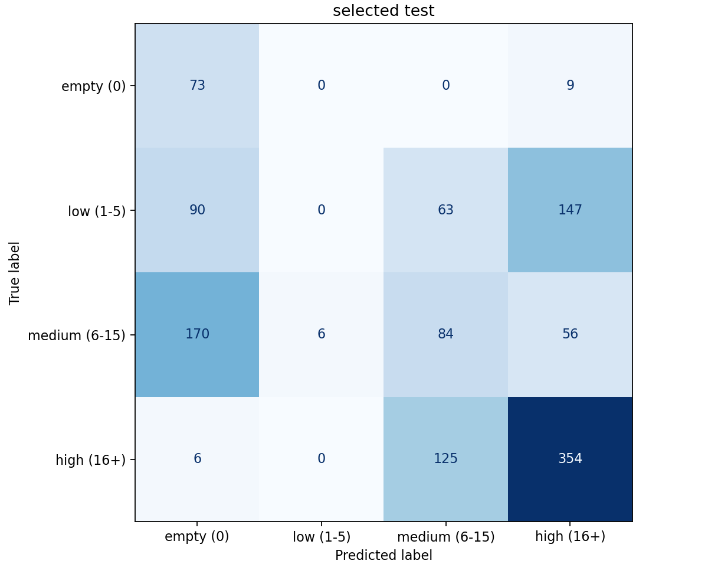

# CO₂ 单特征四分类基线

仅使用CO2C2。随机种子42，固定配置，不搜索参数，不重采样。原始数据及原C2/D_core版本保持不变。

## 冲突排除与划分

复核184个同时间同C2三通道却类别不一致的观测键，现有来源记录不能确定应保留哪个标签。按用户授权排除全部368条对应记录，不猜测或修改标签，得到7,771行新版本。排除日志见excluded_conflicts.csv；全部被排除行原属于候选训练集。其余行维持原候选会话归属，验证/测试没有重新平衡或重新挑选。

| split | rows | fraction | measure_groups | candidate_sessions | class_0 | class_0_sessions | class_1 | class_1_sessions | class_2 | class_2_sessions | class_3 | class_3_sessions |
| --- | --- | --- | --- | --- | --- | --- | --- | --- | --- | --- | --- | --- |
| train | 5355 | 0.6891005018659118 | 29 | 12 | 363 | 7 | 1397 | 11 | 1334 | 12 | 2261 | 12 |
| validation | 1233 | 0.1586668382447561 | 10 | 6 | 100 | 2 | 326 | 6 | 304 | 5 | 503 | 5 |
| test | 1183 | 0.1522326598893321 | 8 | 7 | 82 | 2 | 300 | 7 | 316 | 5 | 485 | 4 |

Measure_ID、候选会话、继承同源组、同时间CO₂键及原始C1/C2同源关联均未跨集合。核查结果和数据哈希见leakage_checks.csv、run_manifest.json。已有同源关系被隔离不等于已证明物理实验完全独立；其余无类别冲突的重复未擅自删除，仍可能影响样本权重。

## 验证集模型比较

| model | accuracy | macro_f1 | balanced_accuracy | empty_precision | empty_recall | empty_f1 |
| --- | --- | --- | --- | --- | --- | --- |
| majority | 0.4079 | 0.1449 | 0.25 | 0.0 | 0.0 | 0.0 |
| random_forest | 0.3601 | 0.3061 | 0.3148 | 0.1786 | 0.2 | 0.1887 |
| svm | 0.4015 | 0.3335 | 0.412 | 0.2527 | 0.46 | 0.3262 |

多数类DummyClassifier(strategy=most_frequent)；随机森林300棵树、min_samples_leaf=3、class_weight=balanced；RBF SVM C=1、gamma=scale、class_weight=balanced。三者均使用Pipeline，SVM中的StandardScaler仅在训练集拟合，其他两者只按列选择CO₂。全部配置在拟合前记录，未使用测试分数调整参数。

按验证集Macro-F1选择 **svm**（平分时依次比较Balanced Accuracy、Accuracy，再按固定模型顺序）。选定后不合并验证集重训，直接评估已保存的训练集模型，因此验证与测试对应同一管线。其他模型不做最终测试集比较。

## 选定模型的最终测试

Accuracy=0.4320，Macro-F1=0.3265，Balanced Accuracy=0.4715。

无人类：Precision=0.2153，Recall=0.8902，F1=0.3468，支持样本=82。无人类识别是否可用应以这些指标为准，不能仅看总体准确率。

| class_id | class_name | precision | recall | f1-score | support |
| --- | --- | --- | --- | --- | --- |
| 0 | empty (0) | 0.2153 | 0.8902 | 0.3468 | 82.0 |
| 1 | low (1-5) | 0.0 | 0.0 | 0.0 | 300.0 |
| 2 | medium (6-15) | 0.3088 | 0.2658 | 0.2857 | 316.0 |
| 3 | high (16+) | 0.6254 | 0.7299 | 0.6736 | 485.0 |

## 评估局限

训练/验证/测试有12/6/7个保守候选会话；无人样本在验证、测试中各仅来自2个会话，分钟记录并非独立实验。此划分允许同校/同教室不同日期跨集合，衡量已知场景下的新批次，不代表新学校泛化或严格未来预测。CO₂受通风、位置和滞后影响，单特征不能唯一确定人数。冲突排除改变训练分布，剩余非冲突行仍需来源核实；这些结果属于首轮基线，不代表部署性能或统计稳定性。零分母Precision/Recall按0报告，未伪造缺类指标。

## 文件与复现

模型：models/co2_baseline_v1/ 下的majority.joblib、random_forest.joblib、svm.joblib（完整Pipeline）。验证集每个模型、测试集选定模型的总体指标/逐类指标/混淆矩阵和预测均保存在本目录；图在results/figures/co2_baseline_v1/。selection.json在测试前落盘，test_evaluation.json绑定模型和选择哈希；重复评估只读取已有结果。

运行 `python src/train.py --run-name co2_baseline_v1`，随后 `python src/evaluate.py --run-name co2_baseline_v1`。已有实验不覆盖；从头复现使用新的run-name，保持同一输入、分组、配置和软件版本。实际版本：{'sklearn': '1.6.1', 'pandas': '2.2.3', 'numpy': '2.1.3', 'joblib': '1.4.2'}。
